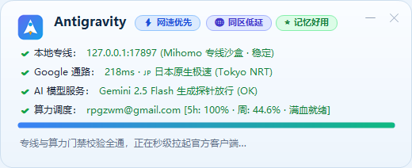

# Antigravity 智能启动器与无感自愈伴侣

  

  <strong>专为 Google Antigravity 开发者打造的 Windows 智能底座</strong> 
  0 杀进程无感秒切号 · 安全须知弹窗全自动穿透 · 原生级深度全中文汉化 · 独立专线隔离 · 智能省额度调度

  
  
  
  
  
  

---

## 💡 为什么需要它？你肯定遇到过这些抓狂瞬间

在使用 Google Antigravity 进行 AI 辅助编程时，你是否也经常遇到以下破坏“心流”的烦恼：

1. 💥 **写代码正起劲，网络突然断流报 400？** 节点一波动或者遇到地区策略限制，任务直接停滞；
2. 🤦 **多账号切个号，传统工具直接暴杀进程？** 啪的一下把整个编辑器强杀了，写到一半的代码、未保存的草稿和终端任务瞬间灰飞烟灭；
3. 🛑 **每次启动或切号，那个“安全须知”弹窗烦不烦？** 每次打开应用或者换完账号，非要弹出一个“安全须知与数据使用（Security Notice & Data Use）”弹窗，强制你手动勾选、手动点击“确认并继续”才让进；
4. 🌐 **满屏英文看花眼，设置里几十个参数不知道啥意思？** 连技能插件列表都是一长串英文标识，底部模型用量还残留着一堆英文徽标和倒计时；
5. 💸 **多个账号额度管理混乱，宝贵的算力白白浪费？** 还有 2 天就清零重置的账号放着不用，反而把刚刷新的新账号额度霍霍完了。

**Antigravity 智能启动器就是为了彻底根治这些痛点而生**——让开发者只管舒舒服服沉浸写代码，把专线保活、故障自愈、0 杀进程秒换号、自动穿透弹窗和深度汉化全部交由后台默默搞定。

---

## 🌟 五大核心人话功能拆解

### 1. ⚡ 真正的 0 杀进程“秒切号”与自动续接
* **绝不关闭你的编辑器**：告别市面上暴力杀进程重启的粗暴做法。切换账号时，仅在后台毫秒级替换认证服务，主窗口和已开标签页**100% 完好常驻**；
* **会话与草稿一个不丢**：正在编写的代码、终端跑着的编译命令、会话里的草稿全部保留；
* **断点自动派发“继续”并复活智能体**：切号完成后，启动器会自动在当前会话里发出“继续”指令，把刚才中断的任务无缝接力下去，连后台休眠的子智能体都会自动扫描唤醒，无需人工盯梢。

---

### 2. 🛡️ 安全须知弹窗“全自动秒点”，彻底解放双手
* **告别手动点击烦恼**：无论是刚开电脑打开应用（冷启动），还是在多账号之间秒切，只要界面冒出“安全须知与数据使用”或“服务条款”弹窗，**启动器毫秒级自动帮你勾选授权复选框，并自动点击“确认并继续”**；
* **双轨极速响应**：前端扩展监听 + 启动后 5 秒高频短轮询，弹窗露头瞬间即被消除；
* **精准安全隔离**：只锁定免责声明与服务条款弹窗，绝不误触你平时的删除对话、设置取消等正常确认框。

---

### 3. 🇨🇳 沉浸式全中文深度汉化（连技能与用量浮窗都翻好了）
* **原生质感，绝不翻页闪现**：采用微任务同步渲染，打开设置或抽屉的第 1 帧直接就是简体中文，告别先英文后跳变的视觉撕裂；
* **设置中心全域汉化**：常规偏好、内置/外部浏览器、语音模式与音量、4K 沉浸模式、快捷键、WSL 环境切换等全部中文化；
* **82 个技能/插件双语标准**：统一采用 `skill-id（中文说明）` 标准（如 `/automation（自动化定时任务创建向导）`），既保留底层命令兼容性，又提供一眼即懂的中文说明；
* **模型选择与用量浮窗深度汉化**：底部模型状态徽标（`提示` / `不可用`）、配额类型（`5小时额度` / `周额度`）、动态剩余百分比（`剩余 31%`）、重置倒计时（`5天 22小时后重置`）全量汉化。

---

### 4. 🔒 完全独立专属专线，不碰你平时的翻墙软件
* **独占专属端口**：启动器为 Antigravity 单独开辟 `127.0.0.1:17897` 独立端口，专线专用；
* **不修改系统代理**：不篡改 Windows 系统的全局代理设置，不开启全局 TUN 网卡；你平时看网页、看视频、微信聊天、打游戏该怎么用就怎么用，两者完全互不干扰、零污染。

---

### 5. 🧠 聪明算力调度，把每一分额度榨出最大价值
* **周额度临期优先消化**：周额度到期不累加直接清零。系统优先调度剩余天数最少、快要重置的账号，绝不让即将过期的额度打水漂；
* **PRO 账号主力加成**：PRO 账号享有主力特权调度加成，优先保障主力号的高阶算力输出，免费账号作为低额救场备用；
* **濒死号与封禁号自动跳过**：额度 <= 5% 的账号自动跳过，遇到需申诉验证的坏号自动避开，防止切入死号导致客户端卡死。

---

## 📸 界面形态一览

| 桌面卡片（编辑器运行时：5秒自动进入 / 一键秒切） | 启动自检卡片（冷启动时：专线与账号四维自检） |
| :---: | :---: |
|  |  |
| *检测到编辑器运行时：显示当前账号与额度，5秒无操作自动进入，或点击切号* | *冷启动时呼出：专线沙盒 / Google链路 / 模型探针 / 算力账号四维透明检测* |

---

## 🚀 极简下载与安装使用（小白友好）

### 选项 1：一键安装包（推荐，新手首选）
1. 前往 [最新发行版页面 (Releases)](https://github.com/zwmopen/Antigravity-Windows-Recovery-Launcher/releases/latest)；
2. 下载 **`Antigravity-Windows-Recovery-Setup-2.9.26-windows-x64.exe`**；
3. 双击运行，按照向导一路点击“下一步”，自动安装并生成桌面图标。

### 选项 2：绿色免安装便携版（解压即用）
1. 前往 [最新发行版页面 (Releases)](https://github.com/zwmopen/Antigravity-Windows-Recovery-Launcher/releases/latest)；
2. 下载 **`Antigravity-Windows-Recovery-Launcher-2.9.26-windows-x64.zip`**；
3. 解压到任意目录（例如 `D:\Tools\Antigravity`），双击 `Antigravity-Recovery-Launcher.exe` 即可启动。

> 💡 **跨电脑迁移超省心**：  
> 只要新电脑上安装了 Clash Verge Rev 或 Mihomo Party 并且导入过订阅，解压本工具后双击就能直接使用，自动搜寻节点，完全不需要手动配置代理！

---

## 🎯 日常使用直觉指南

* **开工写代码**：双击桌面的 `Antigravity 启动器` 图标，卡片会清晰展示当前账号与剩余额度，倒计时 5 秒自动聚焦主窗口，或者直接按回车进入；
* **遇到网络波动或想换线路**：点击卡片上的 **`⚡ 网络自愈重连`**，1 秒在后台自动重连最优专线；
* **额度用完了需要换号**：点击卡片上的 **`优选切号并进入`**，后台秒级完成换号、自动穿透弹窗、自动发送“继续”恢复任务，整个过程编辑器不闪退、不重启；
* **想打开原版客户端**：安装程序同时贴心保留了 `Antigravity 原版` 桌面快捷方式，随时可以直连。

---

## ❓ 常见问题解答 (人话 FAQ)

### Q1: 切号的时候，我写到一半的代码和对话真的不会丢吗？
**真的不会，100% 完好保留！**  
旧款切号工具都是通过杀死 `Antigravity.exe` 进程再重新打开，这种做法非常危险，很容易丢代码和草稿。而本启动器采用**底层动态凭据热更新与语言服务独立热重启**，编辑器主窗口和所有标签页一直保持活着，代码和正在运行的终端任务纹丝不动。

### Q2: 刚开软件弹出的那个“安全须知”弹窗，真的不用我点了吗？
**真的不用点！**  
最新 v2.9.26 版本实装了全自动穿透器。不管是冷启动还是切号后弹出的“安全须知与数据使用”或“服务条款”弹窗，启动器都会在后台毫秒级自动帮你勾选复选框并点击“确认并继续”，你只管专注写代码就行。

### Q3: 这个工具会影响我平时电脑上的微信、浏览器或打游戏吗？
**完全不会。**  
启动器给 Antigravity 分配的是专属的 `127.0.0.1:17897` 独立端口，不修改 Windows 系统的全局代理，也不动你平时用的 Clash（通常是 7897 端口）。你平时的日常上网、打游戏、看视频完全不受任何影响。

### Q4: 我的 Clash 安装在 D 盘或者自定义文件夹，启动器能找到吗？
**完全能找到。**  
启动器需要的是你订阅里的可用节点数据，Windows 规范中这些缓存都在用户目录 `%APPDATA%` 下。启动器会自动识别，不管软件安装在 C 盘还是 D 盘，均可开箱即用。

### Q5: 为什么要把“周额度快过期的账号”排在最前面用？
因为 Google Antigravity 的周额度到期是直接清零重置的，不会滚存累加。  
如果一个账号还有 1 天就重置了，哪怕它只剩 30% 额度，也一定要优先把它用完；如果你放着它不用，反而去用还有 6 天才过期的满血账号，那 1 天后那个账号就白白浪费了 30% 的额度。启动器的调度算法会自动帮你做这道数学题，把算力价值最大化。

### Q6: 如果我不想要了，如何彻底卸载？
- 安装包版：直接在 Windows“设置” -> “已安装的应用”里找到并点击卸载；
- 绿色解压版：运行目录里的 `uninstall.ps1` 即可清理快捷方式与守护进程；
- 卸载非常干净克制，绝不会删除你的项目源码文件或已有账号。

---

## 🛠️ 高级命令行工具速查 (给喜欢敲命令的开发者)

如果你喜欢通过命令行操作，可在安装目录下运行 `Antigravity-QuickSwitch.cmd`：

| 命令 | 一句话说明 |
| :--- | :--- |
| `.\Antigravity-QuickSwitch.cmd` | 智能自动秒切到当前最佳账号 |
| `.\Antigravity-QuickSwitch.cmd --force` | 强制切到评分第一的账号 |
| `.\Antigravity-QuickSwitch.cmd --blocked` | 查看被隔离/封禁的账号看板 |
| `.\Antigravity-QuickSwitch.cmd --unblock <邮箱>` | 申诉或解封后，将账号一键解冻放回算力池 |
| `.\Antigravity-QuickSwitch.cmd --block <邮箱> "原因"` | 手动临时拉黑某个异常账号 |

---

## 📚 延伸文档

* 📋 [v2.9.26 正式版发布说明](docs/RELEASE-NOTES-2.9.26.md)
* 📖 [完整版本演进历史](CHANGELOG.md)
* 🛠️ [踩坑与排障参考](docs/TROUBLESHOOTING.md)

---

## 📄 开源许可证

本项目遵循 [MIT 开源许可证](LICENSE)。
